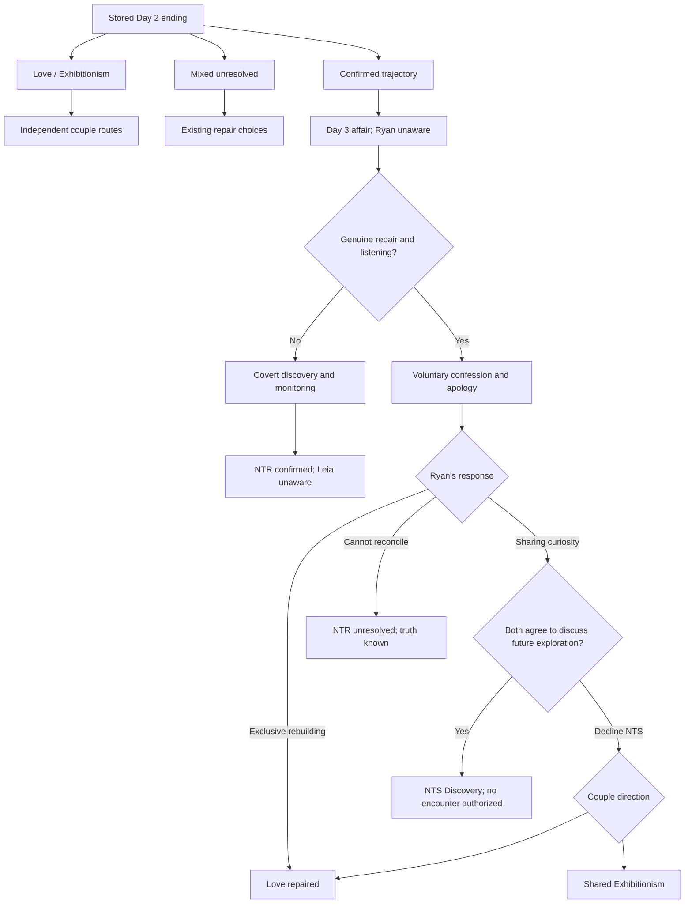

# Days 3–4 overhaul — review handoff

Branch: `feature/day3-day4-narrative-overhaul`. Baseline: main `41913f32e216e9b7cfb96ee7fc5a330468857786`. Scope incorporates the three mid-work amendments: voluntary guilt-driven disclosure, optional NTS Discovery, and a Love/Exhibitionism return when NTS is declined.

## Implemented, not merged

The nightclub event is now a stored fact on the Day Two `ntr_confirmed` trajectory. Adrian Vale, 29, is a visiting sound technician with dry humor, distinct from the cutout stranger and dinner stranger. He knows Leia has a boyfriend and still pursues the connection; neither coercion nor blackmail is implied. Leia's involvement remains her decision. The encounter stays off-screen. Later non-graphic dialogue confirms it; photographs are represented by labeled text placeholders depicting kisses, not explicit imagery.

Ryan remains unaware on Day Three. Julian's dessert surprise for Maya still occupies him. The hairclip, sofa, search, exact `immn the toliet` / `toilet*` messages and unanswered follow-up remain in order. The four messages now use the real phone system with stable IDs; a typing overlay accompanies the pauses. Secret Adrian messages never enter Ryan's ordinary phone threads or Photos app.

Day Four has two distinct responses to that history:

- **Covert discovery:** failed communication at the harbor ends Leia's active repair bids. Ryan later accesses her phone without permission, discovers the affair and ongoing contact, chooses covert monitoring, and learns of the second meeting. Leia does not know what he knows. His nightmare distorts known evidence but adds none. Her later attention to Maya's photographs does not establish anything with Julian.
- **Voluntary disclosure:** genuine repair effort creates an opening for Leia to confess and apologize out of guilt. Ryan takes time before responding. Exclusive rebuilding, NTS Discovery and inability to reconcile are separate outcomes. Curiosity opens a second conversation, not automatic agreement. Declining NTS offers repaired Love or shared Exhibitionism. The earlier betrayal never becomes retroactively consensual.

The fictional Echo screen is a scripted prop containing fixed narrative records. It has no networking, account access, device access, surveillance implementation or installation instructions. Its existence in the fiction does not add those capabilities to the application.

## Route progression

Eligibility for the new confession: Day Three `talk`, Day Four morning `joined`, harbor `fear`, then `disclosure_listen`. Ryan's apology and willingness to hear her precede the confession. The alternative cross-check question remains a final trigger for withdrawal. These are behavioral conditions, not stat thresholds. Chapter Select → Day Four → **Voluntary disclosure / NTS decision** seeds the Day Three repair effort; players still choose whether to join her, listen and pursue NTS.

`mixed_unresolved` retains its existing repair branch and does not receive the new nightclub fact. Day Two `love_repaired` still maps into Day Three Love. A save already beyond Day Three without the new event key is not retroactively assigned an affair; replay Day Three or use the new Day Four presets for the overhaul.

## Scene-by-scene change log

| Scene | Change |
|---|---|
| Prologue, Days 1–2 | No changes. Boutique choice, witness CGs, stare flag and Black Cutout Mini acquisition retained. |
| D3 club entry | Registered nightclub background placeholder replaces the lingering villa background. |
| D3 hairclip | Sequence and route behavior retained. |
| D3 VIP | Adrian introduced with route-aware staging, including Ryan's bar position on `withdraw`. Love/Exhibitionism unchanged. |
| D3 dessert | Records off-screen event truth only on the confirmed trajectory. Ryan's knowledge remains false. Dessert choice and Maya/Julian beat preserved. |
| D3 search | Actual phone delivery of four stable messages; visible typing overlay. No response to the last question. |
| D3 return | Confirmed explanation admits upstairs then bathroom while omitting the encounter. Other trajectory retains its prior explanation. |
| D3 ending | Existing three endings retained; stale Day Four stub comment removed. Dream never sets knowledge. |
| D4 1 | Rephrases dream narration to avoid implying dreams are evidence. |
| D4 2–7 | Existing scenes and choices retained. |
| D4 8 | Confirmed branch receives resentment sequence or earned voluntary disclosure. Older stand-disclosure gate cannot erase the new event. |
| D4 9 | Existing wardrobe scene retained. |
| D4 10 | Mixes a mundane receipt notification with discreet later replies; no screen contents exposed to Ryan. |
| D4 11 | Hike separation preserved; time passes at villa before Maya's private-photo delivery. Leia asks permission to share, shows Ryan, then revisits them. Temporary reassurance applies only before covert discovery. |
| D4 12 | Route guidance distinguishes voluntary honesty from concealed discovery. |
| D4 13 Love | Existing affectionate choice branches retained; final romantic fade moved to 16. |
| D4 13 Exhibitionism | Playful stranger-roleplay, kiss and private opt-out replace the prior exposure escalation. Original image declarations and choice IDs remain registered for compatibility; superseded choices are not offered in fresh play. |
| D4 13 confirmed | Walk, unauthorized phone access, deliberate monitoring, second-meeting evidence and unspoken return. Motive choices change Ryan's inner response, not the required monitoring outcome. |
| D4 13 disclosed | Exclusive repair, sharing curiosity or inability to reconcile; second decision for mutual discussion versus returning to Love/Exhibitionism. |
| D4 14–15 | Knowledge-aware aftermath and boat invitation; disclosed branches do not promise to confess the already-known club story tomorrow. |
| D4 16 | Final private romance, distinct disclosed endings, or evidence-informed nightmare followed by Maya-photo revisiting. Stores one of six ending values. |

## State contract

All new values use the existing save-local `story_values`/`story_flags` dictionaries. No new cross-save `persistent` story variables exist. Missing keys have safe false/unknown defaults. `ch01_d4_lane` retains the day's entry lane; consumers must use `ch01_d4_end_route` and knowledge fields for the outcome.

| Key / group | Meaning |
|---|---|
| `ch01_d3_club_event` | `affair`, `unresolved`, or absent/unknown. Only `affair` establishes the new nightclub fact. |
| `ch01_d3_club_contact_id` | `adrian_vale` or `none`; distinct from existing strangers. |
| `ch01_d3_club_contact_active` | Secret contact continues after the club; suspended by voluntary disclosure. |
| `ch01_d3_club_private_photos` | Adrian possesses their private photos. Does not itself make them available to Ryan. |
| `ch01_d3_leia_knows_club_event` | Leia knows the event occurred. |
| `ch01_d4_ryan_knows_club_event`, `...knows_contact`, `...knows_private_photos` | Ryan's factual knowledge, set only by disclosure/discovery. |
| `ch01_d4_discovery_source` | `voluntary_disclosure` or `covert_phone_access`. |
| `ch01_d4_betrayal_disclosed` | Voluntary confession; independent of Ryan discovering evidence. |
| `ch01_d4_leia_knows_discovery`, `...knows_monitoring` | Leia's knowledge of Ryan's discovery/monitoring. Covert branch leaves both false. |
| `ch01_d4_harbor_approach` | `fear` or `timeline`; dialogue consequence. |
| `ch01_d4_leia_stopped_repair_bids`, `ch01_d4_monitoring_considered` | Flags set by the failed harbor conversation. |
| `ch01_d4_phone_access_without_permission` | Flag recording Ryan's deliberate access; never set on voluntary disclosure. |
| `ch01_d4_monitoring_active`, `...monitoring_reason` | Fictional monitoring, with `need_truth` or `fear_loss` motive. |
| `ch01_d4_second_meeting`, `...ryan_knows_second_meeting`, `...second_meeting_photos` | Separate second-meeting fact, knowledge and photo possession. |
| `ch01_d4_julian_suspicion` | `unconfirmed`; Adrian's betrayal is not evidence involving Julian. |
| `ch01_d4_ryan_sharing_curiosity` | Ryan has expressed interest; not permission or mutual agreement. |
| `ch01_d4_leia_future_interest` | Leia is interested in discussing the possibility, not agreeing to an encounter. |
| `ch01_d4_nts_boundaries_discussed`, `...nts_future_agreed`, `...nts_discovery` | Mutual agreement to discuss possible future sharing. No third-party meeting authorized. |
| `ch01_d4_shared_attention_agreed` | Declined NTS, agreed to couple-centered Exhibitionism. |
| `ch01_d4_maya_photos_shown`, `...maya_photos_revisited` | Photo-sharing/revisiting flags; never establish betrayal involving Julian. |
| `ch01_d4_terrace_roleplay_complete` | New couple roleplay completed. |
| `ch01_d4_end_route` | Existing five values plus `nts_discovery`. Resolver rejects incomplete NTS agreement. |

New choices: `ch01_d4_wall_name_fear`, `...wall_demand_timeline`, `...monitor_need_truth`, `...monitor_fear_loss`, `...roleplay_play`, `...roleplay_watch`, `...disclosure_listen`, `...disclosure_crosscheck`, `...disclosed_exclusive`, `...disclosed_curious`, `...disclosed_unresolved`, `...nts_talk_only`, `...nts_not_ready`, `...back_love`, `...back_exhibition`. All are registered in the existing Choice Engine. Existing choice IDs were not deleted.

## Day Five — planned only, story unchanged

The unchanged Day Five resolver maps an unknown ending to Love. Its confirmed branch also assumes Ryan lacks evidence; its repaired branch expects a deferred confession. To prevent those contradictions, **all branches containing the newly established nightclub event stop after the Day Four ending card**. They can be saved for the next revision. Legacy Love, Exhibitionism and unresolved paths retain their existing link. Day Five remains directly accessible through its unchanged legacy presets.

Future work must consume `nts_discovery`, disclosure source, both characters' knowledge, contact suspension, photo possession, monitoring and second-meeting state. Do not replay the confession or silently forgive betrayal. Sharing curiosity is not approval of any person, act, photograph or arrangement. Distinguish rebuilt exclusive Love, shared attention and potential third-party involvement.

User's **planned** Day Five direction: Ryan becomes seasick, Julian is comfortable on his family's boat, and Ilario becomes an older, burly, experienced male captain. The existing script has Julian seasick and describes a compact female captain. No such changes were implemented. The captain's involvement and all route-specific encounters remain **Pending Approval**.

## Validation and limitations

- Ren'Py 8.5.3.26051504 lint executes successfully as a command but returns **exit 1** under `--error-code`: the same **17 pre-existing diagnostics** as baseline. No new diagnostic lines. See `lint.txt` and baseline comparison in `VALIDATION.md`.
- **114 assertions across 25 parsed-script traversals passed** at the recorded test run. The harness executes actual compiled Python and conditional/menu/jump/call branches, with screen/render/notification interactions stubbed. It is not a rendered playthrough.
- Coverage includes Love, Exhibitionism and private opt-out, all three confirmed Day Three efforts, all new disclosure decisions, refusal of NTS into both couple routes, missed repair, unresolved repair outcomes, all four boutique witness/purchase combinations, registered choice IDs, image registration and gallery seen-state helpers.
- No duplicate label definitions were found by the static label scan. Ren'Py parsing/lint completed without new undefined-label or image diagnostics. No Day 5 file or approved image was changed.
- **Not verified:** visual layout/playthrough, interactive rollback, live save/load, old saves paused within replaced scenes, phone tapping/fullscreen behavior or every combinatorial route. No X server/Xvfb is available here. Fresh Day Three or Day Four Chapter Select runs are recommended for review.
- The optional path is an early conversation about sharing, not a completed new relationship arrangement. It deliberately contains no additional third-party encounter on Day Four.

## Changed-file ownership

| Files | Purpose |
|---|---|
| `ch01_day3_scenes.rpy` | Event recording, Adrian, real search messages. |
| `ch01_day4_scenes_01_08.rpy`, `ch01_day4_scenes_09_16.rpy` | Existing scene-spine integration, repair guards, ending handoff. |
| `ch01_day34_revision_scenes.rpy`, `ch01_day4_disclosure.rpy` | New non-graphic scene dialogue and choices. |
| `ch01_day34_state.rpy` | Event/knowledge predicates, outcome resolver, static evidence records and choice registration. |
| `ch01_day34_visuals.rpy`, `ch01_evidence_screen.rpy` | Labeled placeholders, scripted evidence UI, typing overlay. |
| `ch01_day4_choice_registration.rpy` | Updated route guidance. |
| `chapter_select.rpy`, `chapter_select_screen.rpy` | Confirmed history and disclosure-eligible Day Four preset. |
| `gallery_data.rpy` | Four added placeholder entries; existing IDs preserved. |
| `tools/day34_smoke.rpy`, `docs/day3-day4-overhaul/` | Reproducible checks, reports, plan, asset register and handoff. |
